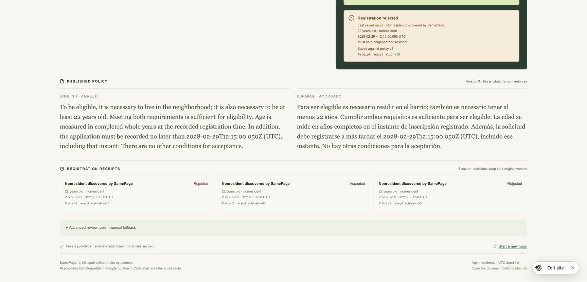

# Fresh hard policies and two simulated editors

20 October 2026: all six newly authored, frozen bilingual policy pairs passed their first interpretation and an independent semantic audit. This was the manual Codex-agent relay, with no Meta/provider API request initiated. It does not establish live Meta performance or cost.

## What was tested

A separate author froze the policies, complete expected rules, and 32 scenario rows before interpretation. A new interpreter received only the six production prompts, without application code, expectations or previous results. Its first responses were preserved and imported unchanged into the deployed private Site. A third agent independently reviewed the original English and Spanish, expectations, translations, structured rules, discoveries, and server receipts.

| Fresh policy pair | Observed result |
| --- | --- |
| Age as a necessary and sufficient qualification versus residency as the sole qualification | Two concrete attendees demonstrate that neither policy is globally stricter. |
| Separate resident and nonresident eligibility routes versus mandatory residency | The two routes collapse to age 22 alone. SamePage discovers a 22-year-old nonresident accepted only by the first interpretation. |
| Registration open through a UTC calendar day versus closing when that day begins | A full day's acceptance differs; a discovered midnight attendee exposes it. |
| Extra older-resident route and adjacent millisecond cutoffs | Correctly equivalent: the additional route admits nobody new, and `<= .624` equals `< .625` in the supported millisecond domain. |
| Age required only for residents, with nonresidents unrestricted | Correctly blocks the whole unsupported negative-residency policy instead of compiling a misleading fragment. The opposite conditional is supported. |
| “You do not have to meet both” versus explicit inclusive OR | Correctly requests clarification: denying that both are necessary does not define what is sufficient. |

Counts: 12 drafts, 10 executable interpretations, two null interpretations with specific issues; **64 scenario checks** (54 Boolean results and 10 abstentions), **four discovered witnesses**, and **eight saved server receipts**. All source-language text was preserved. Single and mismatched approvals preserved the complete published policy in all four fully executable pairs. Both unresolved candidate approvals were rejected. The equivalent pair generated no false conflict.

The [frozen corpus and raw evidence](../tests/semantic/2026-10-20-hard-unseen/) include hashes, prompts, untouched responses, room snapshots, HTTP metadata, screenshots and an [independent audit](../tests/semantic/2026-10-20-hard-unseen/run/independent-review.md). The runner only allows manual room endpoints and rejects redirects; it cannot request the automatic `/review` route. Its original `providerCalls:0` console label was an assertion of the manual path, not provider telemetry; subsequent driver output names the counted automatic-review endpoints explicitly.

## Actual two-tab browser exercise

[Open the private demonstration](https://samepage-language-lab.ampleboar17.chatgpt.site/consequences?room=consequence-0d124fd8-5ec2-4306-93a2-ce0d0a3282b9).

Alice and Bob ran in separate Chrome tabs. Both entered drafts; Alice's save preserved Bob's unsaved text. The generated review prompt exactly matched the frozen complementary-routes case, so its unchanged agent response was replayed for browser verification. This replay is not an additional unseen semantic test.

SamePage found the 22-year-old nonresident without an operator supplying an attendee. The attendee transferred into the form with the exact `2028-02-29T12:15:00.050Z` timestamp. One approval held the published policy; conflicting approvals also held it. Matching approvals published Alice's interpretation as version 2, and the server accepted the attendee.

The audit correctly flagged that the initial version-1 rejection also resulted from its old 2026 deadline, so that comparison did not isolate residency. We then ran an additional browser review: Alice added the meaning-preserving word “exactly,” triggering a fresh prompt and an untouched response from the same isolated interpreter. Both editors approved Bob's resident-only interpretation as version 3. **The identical attendee, age and timestamp changed from accepted at version 2 to rejected at version 3 solely for residency.** Age 22 and the exact deadline stayed the same. The server preserved all three historical receipts, including the original version-1 result. This is one additional review of the same scenario, not a seventh unseen pair.

## Competitive assessment and limits

The strongest reasoning result was recognizing equivalence despite two superficial differences. The most understandable product moment was discovering the nonresident and then observing the two agreed policies produce different real form outcomes. The system also correctly distinguished an unsupported rule from an ambiguous one.

This increases confidence in the bounded mechanism. It does not demonstrate first-place competitiveness: the supported age/residency/deadline language remains small, the model step was manually relayed, and the policy examples were synthetic. Some cases challenge the combination of existing primitives rather than introducing entirely new policy concepts. There were no independent human editors, no live Meta-quality or latency measurements, and no population-impact estimate. Simulated editor IDs are not authentication identities; the Site remains owner-private.

The UI also retained a stale “manual review prompt is ready” notice after import; this did not affect decisions but adds clutter to the demonstration. Source code was not changed during this evaluation. The next discriminator remains the same flow with a live Meta response and policies written by real users, after an explicit paid-testing budget is agreed.
